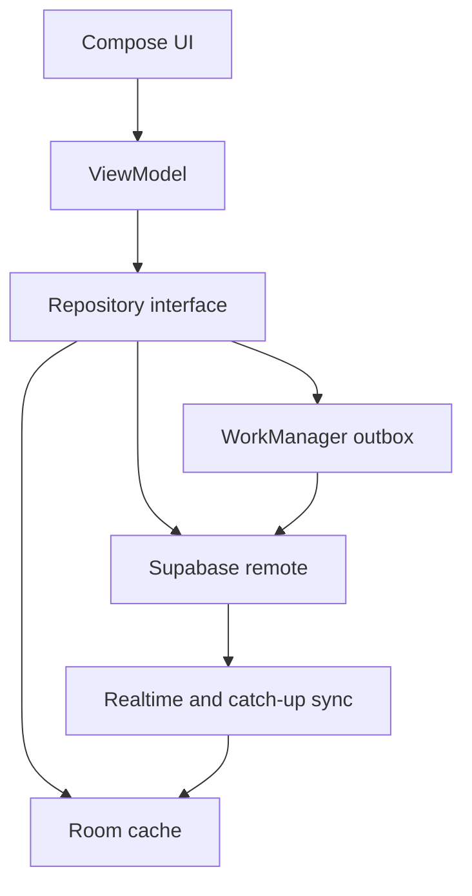

# Pulse architecture

The current single application module contains package boundaries for core model, database, network, data, and feature code. They can become Gradle modules as the app grows without changing the public package root.
